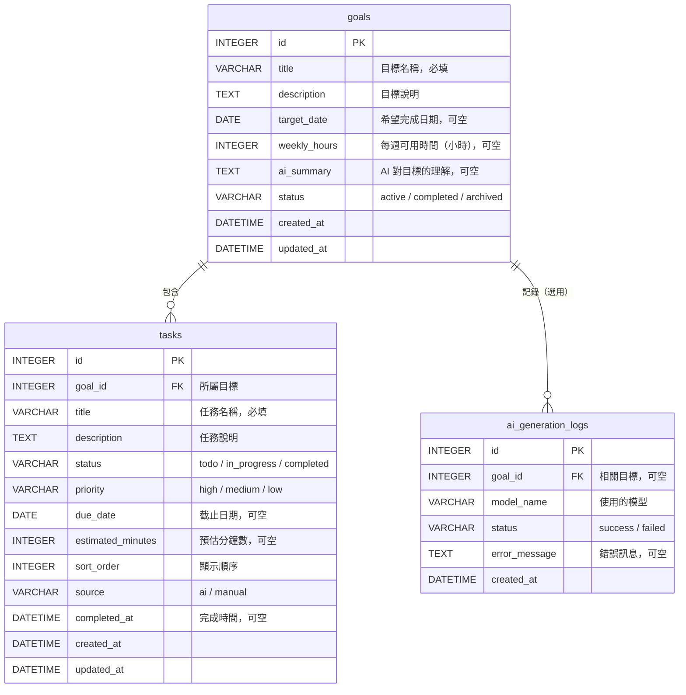

# 資料庫設計（ERD）

第一版採**單一使用者模式**，暫不建立 `users` 資料表；之後若加入登入功能，再於 `goals` 加上 `user_id`。

## 關聯圖

## 關係說明

| 關係 | 說明 |
|---|---|
| goals 1 ── N tasks | 一個目標包含多個任務；刪除目標時，一併刪除其任務 |
| goals 1 ── N ai_generation_logs | 每次呼叫 AI 留一筆紀錄，用來統計成功率與錯誤原因（選用） |

## 與畫面的對應

| 畫面 | 使用的欄位 |
|---|---|
| 新增目標頁 | goals：title、description、target_date、weekly_hours |
| AI 任務預覽頁 | tasks：title、description、priority、due_date、estimated_minutes、sort_order；goals：ai_summary |
| 目標詳情頁 | goals 全部；tasks：status、priority、due_date、estimated_minutes |
| 首頁／進度分析頁 | tasks：status、due_date、completed_at（計算完成率、逾期數） |

## 設計決策

1. **逾期不另存欄位**：「逾期」= 狀態不是 completed 且 `due_date` 早於今天，查詢時即時計算，避免資料不一致。
2. **完成率不另存欄位**：由已完成任務數 ÷ 任務總數即時計算；總數為 0 時顯示 0%。
3. **`source` 欄位**：區分 AI 產生或手動新增的任務，期末可分析「AI 建議被採用的比例」。
4. **AI 的假設（assumptions）不存入資料庫**：只在預覽頁讓使用者確認，確認後就不再需要。
5. **`completed_at`**：標記完成時寫入、重新開啟時清空，用來畫「每日完成數」長條圖。
